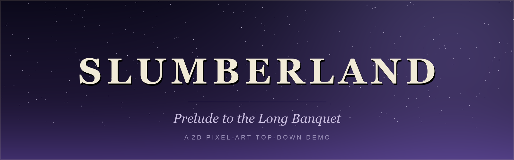
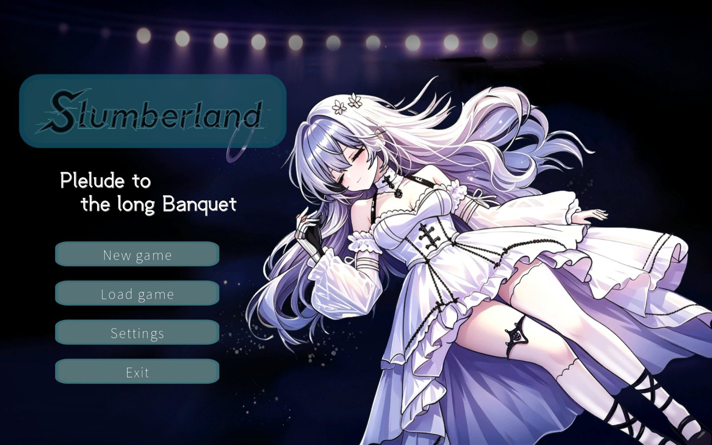
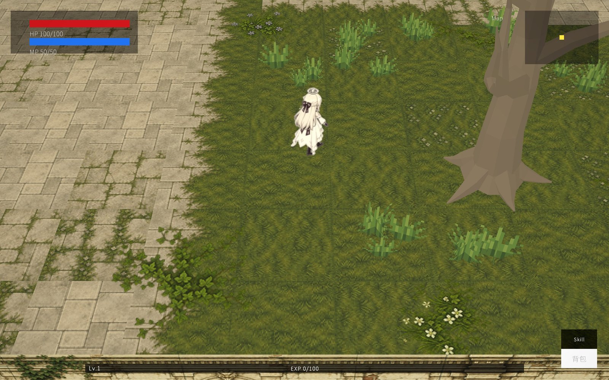
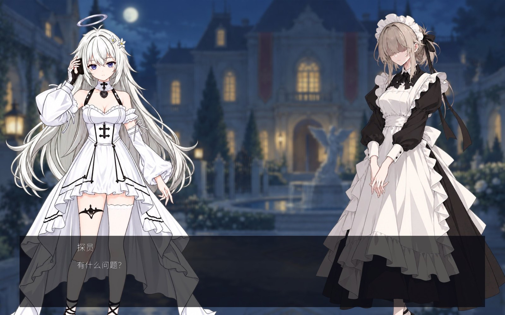

A 2D pixel-art, top-down action demo built with Unity. Wander a quiet pixel world, slash, dash, and poke at everything that looks interactive — doors, chests, altars.

  <b>English</b> · <a href="README.zh-CN.md">简体中文</a>

---

## Screenshots

**Title screen**

**Exploration** — top-down movement, HP / MP in the top-left, EXP bar along the bottom

**Dialogue** — character portraits with a dialogue box

---

## Download & Play

Grab `Slumberland-v0.1.0-win64.zip` (~234 MB) from the **[latest release](https://github.com/Nicolat777/Slumberland/releases/latest)**, unzip it, and run `Slumberland/SL_Game.exe`.

- **OS**: Windows 10 / 11, 64-bit
- **GPU**: anything with DirectX 11 / 12 support
- Portable build — no installation required

> No native macOS / Linux build yet; you'd need a compatibility layer such as Wine.

## Controls

| Input | Action |
|:--|:--|
| `W` `A` `S` `D` | Move |
| `Left Shift` | Dash (on cooldown) |
| `Left Mouse Button` | Attack |
| `E` | Interact with doors, chests, altars, etc. |

## Tech Stack

- **Engine**: Unity 2022.3.57f1 LTS
- **Rendering**: Universal Render Pipeline (2D Renderer)
- **Art**: pixel-art tilemaps & sprite animation
- **Input**: Unity Legacy Input Manager

## About This Repository

This repository ships **playable builds**, not the source project. Each version is attached to a release as a platform-specific archive — see [CHANGELOG](CHANGELOG.md) for build notes.

## Credits

| Asset | Author |
|:--|:--|
| Pixel Art Top Down - Basic | [Cainos](https://assetstore.unity.com/publishers/45656) |
| Hero Knight - Pixel Art | Sven Thole |
| Unity Engine & URP | Unity Technologies |

Third-party assets remain the property of their respective authors and are used here for demo / learning purposes.

---

## License

**All rights reserved.** This repository grants no open-source license. See [LICENSE](LICENSE) for the full terms, and [THIRD-PARTY-NOTICES](THIRD-PARTY-NOTICES.md) for third-party assets.

| Allowed | Not allowed |
|:--|:--|
| Download and play the official builds (personal, non-commercial) | Copy, modify, or redistribute the code |
| Browse the repository, share links | Re-upload builds, extract assets |
| Quote short excerpts in reviews / commentary | Use in other products or commercially |

Any use beyond the above requires prior written permission from the author.

> Repository contents © 2026 Nicolat777. Third-party art assets (Cainos, Hero Knight) and the Unity engine are **not** covered by this notice — see [THIRD-PARTY-NOTICES](THIRD-PARTY-NOTICES.md).
